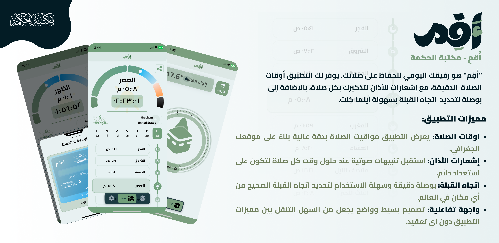

<p align="center">
	
</p>

# أَقِم — Aqim

تطبيق مواقيت الصلاة والقبلة البسيط والدقيق. Flutter app for Prayer Times and Qibla.

—

## المحتويات · Table of Contents

- [العربية](#العربية)
	- [نبذة](#نبذة)
	- [المميزات](#المميزات)
	- [الأذونات والخصوصية](#الأذونات-والخصوصية)
	- [التثبيت والتشغيل](#التثبيت-والتشغيل)
	- [النشر والإصدارات](#النشر-والإصدارات)
- [English](#english)
	- [Overview](#overview)
	- [Features](#features)
	- [Permissions & Privacy](#permissions--privacy)
	- [Build & Run](#build--run)
	- [Releasing](#releasing)

<p align="center">
	
</p>

---

## العربية

### نبذة

تطبيق "أَقِم" هو تطبيق إسلامي بسيط ومباشر، مصمم خصيصًا لمساعدتك على أداء صلاتك في وقتها وبكل سهولة. يركز التطبيق على تقديم الأدوات الأساسية التي يحتاجها كل مسلم في حياته اليومية، من خلال واجهة تفاعلية سهلة الاستخدام تضمن لك تجربة مريحة وواضحة. مع "أَقِم"، لن تفوتك أي صلاة بعد الآن؛ إذ يعمل التطبيق كمُنبه شخصي وموجّه دقيق لقبلتك، مما يجعله الأداة المثالية للحفاظ على أهم أركان الإسلام.

### المميزات

- أوقات الصلاة: يعرض التطبيق مواقيت الصلاة بدقة عالية بناءً على موقعك الجغرافي.
- إشعارات الأذان: استقبل تنبيهات صوتية عند حلول وقت كل صلاة لتكون على استعداد دائم.
- اتجاه القبلة: بوصلة دقيقة وسهلة الاستخدام لتحديد اتجاه القبلة الصحيح من أي مكان في العالم.
- واجهة تفاعلية: تصميم بسيط وواضح يجعل من السهل التنقل بين مميزات التطبيق دون أي تعقيد.

### الأذونات والخصوصية

- الموقع: لاستخدام الحسابات الدقيقة لمواقيت الصلاة وتحديد اتجاه القبلة.
- الإشعارات: لإرسال التنبيهات عند دخول وقت الصلاة.

نلتزم باحترام خصوصيتك وعدم جمع أي بيانات شخصية غير ضرورية.

### التثبيت والتشغيل

متطلبات أساسية:

- Flutter SDK 3.22+ (أو الأحدث)
- Xcode/Android Studio وأدوات المنصات ذات الصلة

خطوات سريعة:

1) تثبيت الحزم:

```bash
flutter pub get
```

2) تشغيل التطبيق على جهاز/محاكي متصل:

```bash
flutter run
```

3) إنشاء نسخة إنتاجية (اختياري):

```bash
# Android
flutter build apk --release

# iOS (يتطلب macOS وXcode)
flutter build ipa --release
```

> مراقبة الأخطاء عبر Sentry مفعّلة مؤقتاً (DSN مضمّن في `lib/core/services/sentry_service.dart`) لأغراض التشخيص — تُحذف المكتبة بالكامل قبل رفع التطبيق للمتجر.

> يدعم التطبيق تعدد اللغات عبر ملفات `assets/locales/*.json`.

### النشر والإصدارات

الرفع للمتاجر يتم عبر GitHub Actions بworkflows يدوية التشغيل (نفس نمط مستودع alquranalkareem). طقس كل إصدار:

1. ارفع `version:` في `pubspec.yaml` (مثل `1.2.17+24`).
2. اكتب ملاحظات الإصدار في `release_notes/<الإصدار-الكامل>/ar.md` (`en.md` اختياري) — الـworkflow يفشل إن غاب ملف العربية.
3. شغّل الـworkflow المطلوب يدويًا من تبويب Actions:

| الـWorkflow | الوجهة | ملاحظات |
|---|---|---|
| `release-play` | Google Play (production) | AAB بنكهة `googlePlayRelease`، ملاحظات whatsnew تلقائيًا من `release_notes` — الإرسال للمراجعة يدويًا من Play Console |
| `release-testflight` | TestFlight (iOS) | إرسال نسخة App Store للمراجعة يدويًا من App Store Connect |
| `release-appgallery` | Huawei AppGallery (مسودة) | APK بتوقيع هواوي — المراجعة يدويًا |
| `release-github` | GitHub Release مرقّم `v<الإصدار>` | تحميلات مباشرة: Android/macOS (موقّع وموثّق Developer ID)/Linux |
| `release-mac-appstore` | Mac App Store (TestFlight) | حزمة `.pkg` موقّعة |

الأسرار (تُضبط مرة واحدة عبر `./set-store-secrets.sh` من جذر المستودع):

| السر | المستوى | المصدر |
|---|---|---|
| `MAPTILER_KEY` | المستودع | مفتاح MapTiler |
| `PLAY_KEYSTORE_BASE64/PASSWORD/ALIAS/KEY_PASSWORD` | المستودع | `android/google-play-keystore.jks` + `google-play-key.properties` |
| `PLAY_SERVICE_ACCOUNT_JSON` | المستودع | حساب خدمة من Play Console بوصول للتطبيق |
| `HUAWEI_KEYSTORE_BASE64/PASSWORD/ALIAS/KEY_PASSWORD` | المستودع | `android/huawei-release-key.keystore` + `key.properties` |
| `IOS_PROFILE_BASE64` / `IOS_PROFILE_WIDGET_BASE64` | المستودع | بروفايل App Store جديد لـ`com.alheekmah.aqimApp` وللويدجت `...prayerWidget` |
| `MAS_PROFILE_BASE64` / `MAS_PROFILE_WIDGET_BASE64` | المستودع | بروفايل Mac App Store (المنصة macOS حصريًا) للتطبيق والويدجت |
| `IOS_P12_BASE64/PASSWORD` | المستودع (مشترك) | شهادة Apple Distribution (نفس قيم تطبيق القرآن) |
| `MAC_DEV_ID_P12_BASE64/PASSWORD` | المستودع (مشترك) | شهادة Developer ID Application |
| `MAS_INSTALLER_P12_BASE64/PASSWORD` | المستودع (مشترك) | شهادة 3rd Party Mac Developer Installer |
| `ASC_KEY_ID/ISSUER_ID/KEY_P8_BASE64` | المستودع (مشترك) | مفتاح App Store Connect API |
| `AGC_CLIENT_ID/SECRET` | المستودع (مشترك) | عميل Publishing API من AppGallery Connect |

> «مشترك» تعني نفس القيم المعتمدة في مستودع القرآن لكنها تُضبط على مستوى كل مستودع — حساب `alheekmahlib` شخصي، وأسرار مستوى المؤسسة غير متاحة على GitHub للحسابات الشخصية.

> تذكير: الـbuildType الافتراضي `release` موقّع بمفتاح هواوي، وبناء Play يستخدم `--flavor googlePlayRelease`. اعتمادية `floatica` تُسحب في CI كمستودع شقيق تلقائيًا.

---

## English

### Overview

“Aqim” is a simple and focused Islamic app built to help you pray on time with ease. It provides the essential daily tools for every Muslim with a clean, interactive UI for a clear and comfortable experience. With Aqim, you won’t miss a prayer again—think of it as your personal reminder with accurate Qibla guidance.

### Features

- Prayer Times: Highly accurate timings based on your geographic location.
- Adhan Notifications: Receive audible alerts when it’s time to pray.
- Qibla Direction: A precise and easy-to-use compass to find the Qibla anywhere.
- Interactive UI: A clean, straightforward design that’s effortless to navigate.

### Permissions & Privacy

- Location: Required for accurate prayer times and Qibla direction.
- Notifications: To alert you at prayer times.

We respect your privacy and do not collect unnecessary personal data.

### Build & Run

Prerequisites:

- Flutter SDK 3.22+ (or newer)
- Xcode/Android Studio with platform toolchains

Quick start:

1) Install dependencies:

```bash
flutter pub get
```

2) Run on a connected device/emulator:

```bash
flutter run
```

3) Build release (optional):

```bash
# Android
flutter build apk --release

# iOS (requires macOS & Xcode)
flutter build ipa --release
```

> Error monitoring via Sentry is enabled temporarily (DSN embedded in `lib/core/services/sentry_service.dart`) for diagnosis — remove the library entirely before publishing to app stores.

### Releasing

Store uploads run through manually-triggered GitHub Actions workflows (same setup as the alquranalkareem repo). Release ritual:

1. Bump `version:` in `pubspec.yaml` (e.g. `1.2.17+24`).
2. Write `release_notes/<full-version>/ar.md` (`en.md` optional) — workflows fail fast if the Arabic notes file is missing.
3. Run the desired workflow from the Actions tab:

| Workflow | Target | Notes |
|---|---|---|
| `release-play` | Google Play (production) | AAB via the `googlePlayRelease` build type, what's-new from `release_notes` — press "Send for review" in Play Console |
| `release-testflight` | TestFlight (iOS) | App Store submission stays manual in App Store Connect |
| `release-appgallery` | Huawei AppGallery (draft) | Huawei-signed APK — review submission manual |
| `release-github` | Versioned GitHub Release `v<version>` | Direct downloads: Android/macOS (Developer ID signed + notarized)/Linux |
| `release-mac-appstore` | Mac App Store (TestFlight) | Signed `.pkg` |

Secrets are configured once via `./set-store-secrets.sh` from the repo root: app-specific secrets (Android keystores, provisioning profiles, Play service account) and shared ones (Apple Distribution, Developer ID, Mac Installer, ASC API key, AGC client — same values as the Quran repo) all live at repo level, since the `alheekmahlib` account is personal and GitHub org-level secrets are unavailable. The default `release` build type is Huawei-signed; Play builds use `--flavor googlePlayRelease`. The `floatica` dependency is checked out as a sibling repo in CI automatically.

—

Made with Flutter. If you have suggestions or find issues, please open an issue or a pull request.
